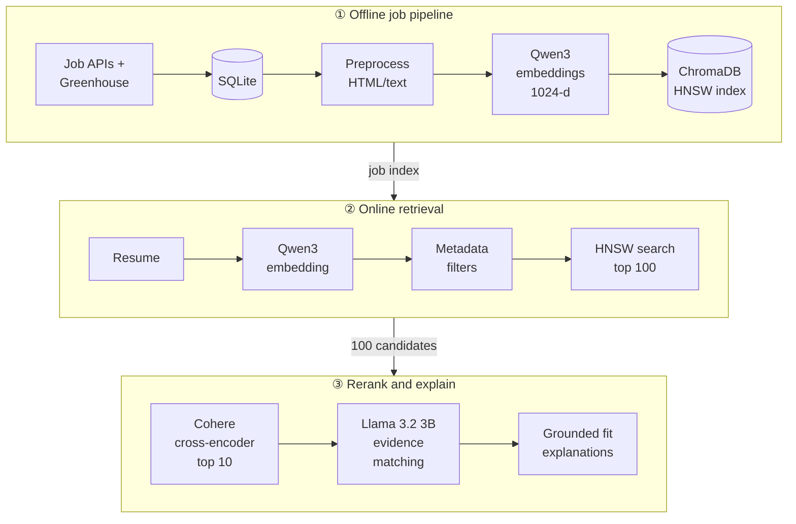

# Resume-Job Matching System

[](https://github.com/eesha-charaya/Resume-Job-Matching-System/actions/workflows/collect.yml)


A retrieval-augmented (RAG) system that matches a resume to relevant job postings and explains each match. It retrieves candidates with dense embeddings and HNSW vector search, reranks them with a cross-encoder, and generates grounded fit explanations with a local LLM.

## Results

Evaluated on a held-out test set of resumes, with synthetic relevant jobs inserted into a corpus of sampled real postings:

| Metric | Score |
| --- | --- |
| Precision@5 | **0.92** |
| Recall@10 | **0.91** |

Scale: run end-to-end over **3.2K+ real job postings** collected from 8+ job APIs and Greenhouse boards.

## Architecture



The design is a classic two-stage retriever: fast, broad recall from the vector index, then a more expensive cross-encoder that reads the resume and each job together for precision.

## Tech Stack

| Component | Technology | Purpose |
| --- | --- | --- |
| Job collection | 8+ job APIs + Greenhouse, scheduled with GitHub Actions | Build and refresh the job corpus |
| Storage | SQLite | Raw jobs, cleaned jobs, serialized embeddings |
| Embeddings | `Qwen/Qwen3-Embedding-0.6B` (local) | 1024-dimensional dense vectors |
| Vector retrieval | ChromaDB + HNSW | Approximate nearest-neighbor semantic search |
| Reranking | Cohere `rerank-english-v3.0` | Cross-encoder relevance scoring |
| Local LLM | Ollama + `llama3.2:3b-instruct-q4_K_M` | Requirement extraction and fit explanations |
| API | FastAPI + Docker + nginx | Matching and health endpoints |
| Evaluation | Precision@5 / Recall@10 + MLflow | Held-out retrieval evaluation |
| Testing | pytest | Unit tests for pipeline, eval and API |

## Design Decisions

**Why HNSW?** A graph-based approximate nearest-neighbor index gives fast, high-recall retrieval without comparing the resume against every job vector.

**Why rerank after embeddings?** Dense retrieval embeds each document independently. A cross-encoder scores the resume and a job together, which gives a stronger relevance signal, applied only to the top 100 candidates to keep cost low.

**Why local embeddings and generation?** Running Qwen and Llama locally removes per-call API cost and external dependency for the core representation and explanation steps.

**Why evaluate retrieval separately from generation?** A job can be retrieved correctly even when the explanation is weak, so retrieval metrics are measured independently of generation quality.

## Retrieval Configuration

Defaults from `src/config.py`:

```text
Embedding model: Qwen/Qwen3-Embedding-0.6B
Embedding dimension: 1024
Retrieve top K: 100
HNSW ef_construction: 400
HNSW ef: 400
Rerank top N: 10
```

## Quickstart

```bash
# 1. Environment
python -m venv .venv && source .venv/bin/activate
pip install -r requirements.txt
cp .env.example .env          # add COHERE_API_KEY (+ job API keys if collecting)

# 2. Local LLM
ollama pull llama3.2:3b-instruct-q4_K_M

# 3. Build the corpus
python data_pipeline/collect_jobs.py
python scripts/pipeline/preprocess_jobs.py --db-path data/jobs.db
python scripts/pipeline/embed_jobs.py --db-path data/jobs.db

# 4. Match a resume (reads data/user_profile.txt, writes matched_jobs.md)
python scripts/pipeline/match_jobs.py --db-path data/jobs.db
```

Local Qwen embeddings need no API key. `COHERE_API_KEY` is required for reranking.

### Run the API with Docker

```bash
docker compose up --build
```

| Endpoint | Description |
| --- | --- |
| `GET /health` | Liveness check |
| `GET /ready` | Checks SQLite, ChromaDB, Qwen embedding inference and Ollama |
| `POST /match` | Embeds a resume, retrieves and reranks jobs, returns matches with explanations |

## Evaluation

```bash
# Full pipeline (dense retrieval + reranking)
python scripts/eval/run_test_eval.py --db-path data/jobs.db

# Dense retrieval only
python scripts/eval/run_test_eval.py --db-path data/jobs.db --skip-rerank
```

- **Precision@5**: share of the top five returned jobs that are known relevant positives.
- **Recall@10**: share of known relevant positives that appear in the top ten.

Results and diagnostics are written to the evaluation results directory and logged to MLflow.

## Project Structure

```text
data_pipeline/          Job collectors (APIs, Greenhouse), DB schema and migrations
src/
  embedding.py          Local Qwen embedding loading and batching
  retrieval.py          ChromaDB collection and HNSW retrieval
  reranking.py          Cohere cross-encoder reranking
  regex_extraction.py   Deterministic metadata extraction and filters
  llm_extraction.py     Optional local LLM fallback for metadata
  generation.py         Grounded requirement/evidence matching and explanations
scripts/pipeline/       Preprocess, embed and match entry points
scripts/eval/           Synthetic data generation, tuning and test evaluation
fastapi_app/            FastAPI service
docker/                 Dockerfile and nginx config
tests/                  pytest suite
```

## Testing

```bash
pytest
```
